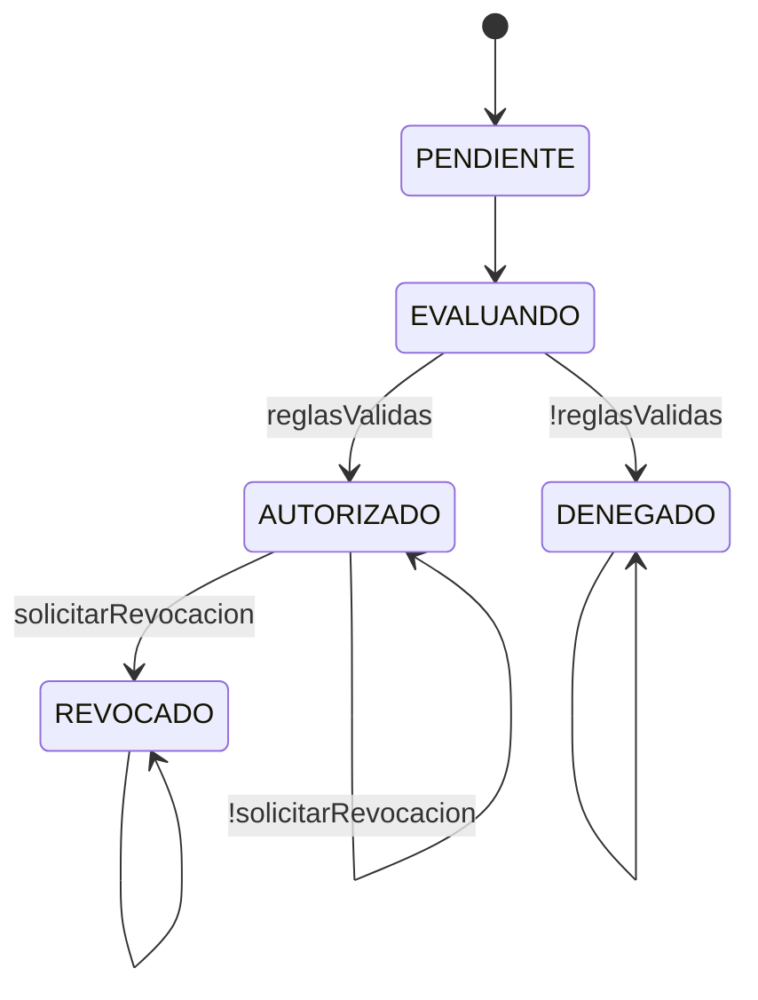

# E9: Transiciones de estado y Model Checking

## 1. Objetivo y base

Se verifica una abstraccion finita del ciclo de una solicitud de acceso
del proyecto Zero-Trust-VDM. Se utilizan NuSMV y propiedades temporales.
La base es el commit `83a44ff002e85946614cef0be5060b5fd8c2a95e` de `main`.

Codigo consultado:
- `model/Tipos.vpp`: estados disponibles.
- `model/SolicitudAcceso.vpp`: datos y riesgo entre 0 y 100.
- `model/MotorZeroTrust.vpp`: invariantes, EvaluarAcceso y RevocarAcceso.

La especificacion ejecutable esta en `model-checking/zero_trust.smv`.
No se modifican los archivos VDM++.

## 2. Estados y transiciones

| Estado | Razon de existir |
| --- | --- |
| PENDIENTE | Representa una solicitud nueva antes de iniciar la evaluacion. |
| EVALUANDO | Hace explicita la fase conceptual de comprobacion. |
| AUTORIZADO | La solicitud cumple todas las reglas. No asigna un permiso nuevo. |
| DENEGADO | La solicitud incumple alguna regla de acceso. |
| REVOCADO | Se retiro una autorizacion previa mediante una llamada explicita. |



Los bucles finales permiten representar ejecuciones infinitas para la logica
temporal; no significan que se vuelva a procesar la solicitud.
La solicitud comienza su evaluacion sin espera en esta abstraccion.
En VDM++, EvaluarAcceso ejecuta la decision en una operacion y agrega el
registro resultante; no persiste EVALUANDO. No se supone que ese estado
intermedio ya este implementado.

## 3. Variables y relacion con VDM++

| Variable NuSMV | Dominio | Correspondencia |
| --- | --- | --- |
| usuarioRegistrado | boolean | Pertenencia de sol.usuario a dom usuarios. |
| usuarioActivo | boolean | EsActivo() del usuario consultado. |
| recursoRegistrado | boolean | Pertenencia de sol.recurso a dom recursos. |
| permiso | boolean | Usuario en dom permisos y recurso en su conjunto. |
| dispositivoValido | boolean | Campo de la solicitud. |
| riesgo | 0..100 | Campo de la solicitud con su invariante de rango. |
| recursoCritico | boolean | EsCritico() del recurso consultado. |
| mfaVerificado | boolean | Campo de la solicitud. |
| estado | cinco estados | Fase conceptual o decision de la solicitud. |
| estadoAnterior | cinco estados | Auxiliar de verificacion para revisar el origen de REVOCADO. |
| solicitarRevocacion | boolean | Evento externo de llamada explicita para el ID de esta solicitud. |
| registros | 0..1 | Cantidad de entradas para la unica solicitud representada. |

Las primeras ocho variables son FROZENVAR: NuSMV contempla los contextos
iniciales admisibles y conserva sus datos en cada recorrido. Los atributos
de una entidad inexistente son irrelevantes: la regla exige su existencia
antes de autorizar.

La condicion inicial `permiso -> (usuarioRegistrado & recursoRegistrado)`
representa la integridad referencial E6. No representa los mapas completos.
El ID unico se asume porque se estudia una solicitud nueva; no se verifica aqui
el rechazo de solicitudes duplicadas. El rol no se agrega como criterio
porque EvaluarAcceso no consulta GetRol().

## 4. Condicion de autorizacion

```text
reglasValidas =
  usuarioRegistrado AND usuarioActivo AND recursoRegistrado
  AND permiso AND dispositivoValido AND riesgo < 80
  AND (NOT recursoCritico OR mfaVerificado)
```

Todas las reglas deben cumplirse. Si el recurso no es critico, no se exige
MFA. Un riesgo de 80 ya se deniega. El rango 0..100 se conserva sin agrupar
valores para poder comprobar exactamente los limites 79 y 80.

## 5. Asignaciones

| Situacion | Asignacion | Motivo |
| --- | --- | --- |
| Inicio | estado=PENDIENTE; registros=0 | Solicitud nueva aun sin decision registrada. |
| PENDIENTE | next(estado)=EVALUANDO | Inicia el procesamiento conceptual. |
| EVALUANDO y reglasValidas | next(estado)=AUTORIZADO; next(registros)=1 | Decision positiva y entrada al historial. |
| EVALUANDO y !reglasValidas | next(estado)=DENEGADO; next(registros)=1 | Decision negativa y entrada al historial. |
| AUTORIZADO y solicitarRevocacion | next(estado)=REVOCADO | Retira la autorizacion. registros se conserva. |
| Cualquier paso | next(estadoAnterior)=estado | Conserva la fase previa para verificar la transicion. |

En NuSMV, las asignaciones next se calculan con el estado actual y se
actualizan simultaneamente. Los estados sin otra transicion se conservan.
La revocacion puede solicitarse o no; no se impone que toda autorizacion
termine revocada. Una solicitud de revocacion fuera de AUTORIZADO no cambia
el estado en esta abstraccion. No se reproduce el error de precondicion
de llamar RevocarAcceso con historial vacio: solo se representa el efecto
de las llamadas aplicables despues de evaluar la solicitud.

En VDM++, `mu(sol, estado |-> decision)` crea el registro con la decision y
`historial := historial ^ [solEvaluada]` lo agrega. RevocarAcceso reconstruye
el historial cambiando el registro autorizado, sin aumentar su longitud.
Aqui se abstrae ese efecto mediante registros=0 o 1; no se prueba el bucle
sobre historiales de longitud arbitraria.

## 6. Propiedades principales

G significa siempre; F, en algun momento futuro; X, en el paso siguiente.

**P1. Seguridad de autorizacion**

```smv
G (estado = AUTORIZADO -> reglasValidas)
```

Nunca se autoriza una solicitud si falta alguna regla, incluido el permiso.
Esta propiedad refuerza la propiedad de seguridad que ya estaba propuesta
en este documento.

**P2. Finalizacion de la evaluacion**

```smv
G (estado = EVALUANDO -> F (estado = AUTORIZADO | estado = DENEGADO))
```

Toda evaluacion alcanza una decision. El modelo supone que el motor procesa
la solicitud sin bloqueo externo; no demuestra tiempos de respuesta ni
ausencia de bloqueos de una implementacion concurrente real.

**P3. Origen valido de la revocacion**

```smv
G ((estado = REVOCADO & estadoAnterior != REVOCADO) ->
   estadoAnterior = AUTORIZADO)
```

El primer ingreso a REVOCADO viene de AUTORIZADO.

**P4. Efecto de una llamada de revocacion aplicable**

```smv
G ((estado = AUTORIZADO & solicitarRevocacion) -> X (estado = REVOCADO))
```

**P5. La revocacion conserva la cantidad de entradas**

```smv
G ((estado = AUTORIZADO & solicitarRevocacion & registros = 1) ->
   X (estado = REVOCADO & registros = 1))
```

**P6. Las decisiones estan registradas**

```smv
G ((estado = AUTORIZADO | estado = DENEGADO | estado = REVOCADO) ->
   registros = 1)
```

P1 y P2 cubren el minimo de dos propiedades con G/F pedido por la consigna.
P3 a P6 complementan la verificacion del comportamiento y la revocacion.

## 7. Alcanzabilidad y escenarios complementarios

El archivo contiene siete comprobaciones CTL con EF (existe un recorrido
que finalmente alcanza la condicion), condicionadas por los datos iniciales:

- Con reglas validas se puede alcanzar AUTORIZADO.
- Con reglas invalidas se puede alcanzar DENEGADO.
- Con reglas validas existe un recorrido hacia REVOCADO.
- Con reglas validas y riesgo 79 se puede autorizar.
- Con riesgo 80, cumpliendose las demas reglas, se deniega.
- En un recurso critico sin MFA, cumpliendose lo demas, se deniega.
- En un recurso no critico se puede autorizar sin MFA si se cumple lo demas.

NuSMV comprueba las especificaciones en todos los estados iniciales.
Por eso se usa, por ejemplo, `reglasValidas -> EF (estado = AUTORIZADO)`:
no se exige que un contexto invalido y fijo pueda autorizarse.
El conjunto inicial admite tanto contextos validos como invalidos y todos los
valores del riesgo 0..100 compatibles con la integridad referencial.
Estas comprobaciones complementan las propiedades LTL y permiten revisar
recorridos con autorizacion, denegacion y revocacion.

## 8. Ejecucion y resultados

Se ejecuto el archivo final con NuSMV 2.7.1 en Linux de 64 bits.
Resultado: **13 especificaciones verdaderas: 6 LTL y 7 CTL**.
Estos resultados corresponden a la abstraccion descrita, no a una nueva
ejecucion de las pruebas VDM++ ni a la infraestructura empresarial real.

Comando reproducible desde la raiz, si NuSMV esta en PATH:

```bash
NuSMV model-checking/zero_trust.smv
```

Las rutas para Windows e instrucciones de simulacion estan en
`model-checking/README.md`.

### Salida real de las especificaciones

```text
-- specification (reglasValidas -> EF estado = AUTORIZADO)  is true
-- specification (!reglasValidas -> EF estado = DENEGADO)  is true
-- specification (reglasValidas -> EF estado = REVOCADO)  is true
-- specification ((reglasValidas & riesgo = 79) -> EF estado = AUTORIZADO)  is true
-- specification (((((((riesgo = 80 & usuarioRegistrado) & usuarioActivo) & recursoRegistrado) & permiso) & dispositivoValido) & (!recursoCritico | mfaVerificado)) -> EF estado = DENEGADO)  is true
-- specification ((((((((recursoCritico & !mfaVerificado) & usuarioRegistrado) & usuarioActivo) & recursoRegistrado) & permiso) & dispositivoValido) & riesgo < 80) -> EF estado = DENEGADO)  is true
-- specification (((reglasValidas & !recursoCritico) & !mfaVerificado) -> EF estado = AUTORIZADO)  is true
-- specification  G (estado = AUTORIZADO -> reglasValidas)  is true
-- specification  G (estado = EVALUANDO ->  F (estado = AUTORIZADO | estado = DENEGADO))  is true
-- specification  G ((estado = AUTORIZADO & solicitarRevocacion) ->  X estado = REVOCADO)  is true
-- specification  G ((estado = REVOCADO & estadoAnterior != REVOCADO) -> estadoAnterior = AUTORIZADO)  is true
-- specification  G (((estado = AUTORIZADO & solicitarRevocacion) & registros = 1) ->  X (estado = REVOCADO & registros = 1))  is true
-- specification  G (((estado = AUTORIZADO | estado = DENEGADO) | estado = REVOCADO) -> registros = 1)  is true
```

### Comprobacion de sensibilidad

En copias temporales, excluidas del paquete, se hicieron dos cambios
incorrectos a proposito: autorizar sin revisar las reglas y permitir que
una evaluacion valida se quede en EVALUANDO. NuSMV detecto respectivamente
el incumplimiento de P1 y P2. El archivo incluido conserva las reglas
correctas y se verifico con las 13 especificaciones verdaderas.

## 9. Conclusiones

Los estados separan procesamiento, autorizacion, denegacion y retiro de una
autorizacion. Las variables representan los datos que consulta el motor.
Las condiciones delimitan cuando autorizar y las asignaciones registran
la decision o cambian el estado tras una revocacion.

La verificacion realizada respalda las propiedades de este modelo finito.
Se estudia una solicitud, sin concurrencia, datos cambiantes ni historia
arbitrariamente grande. No es una prueba de equivalencia entre NuSMV y
VDM++, ni una prueba de seguridad de una implementacion desplegada.

## 10. Referencias de herramienta

- Descargas oficiales: https://nusmv.fbk.eu/downloads.html
- Tutorial NuSMV: https://nusmv.fbk.eu/tutorials.html
- Manual NuSMV: https://nusmv.fbk.eu/user-manual.html

