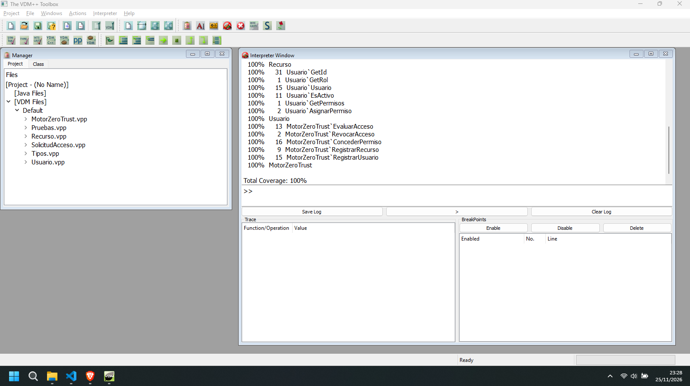

# E8 · Pruebas y cobertura del motor Zero Trust

En The VDM++ Toolbox v9.0.7 las seis clases pasaron el análisis de sintaxis y tipos. Con la comprobación dinámica de tipos, invariantes, precondiciones y poscondiciones activada, todos los resultados coincidieron con los esperados. El intérprete registró cinco rechazos por precondición y uno por invariante. La cobertura total reportada por `rtinfo` fue del **100 %**.

## Reproducir la ejecución

1. En **Project → New Project**, crea un proyecto de trabajo. En **Project → Add File to Project**, añade los seis archivos `.vpp` de [model](../model/). Si ya estaban cargados, selecciona los archivos y vuelve a analizarlos.
2. Selecciona los archivos en **Manager** y pulsa **Actions → Syntax Check**. Selecciona las clases y pulsa **Actions → Type Check**. Comprueba que las seis pasan.
3. En **Project → Project Options → Interpreter**, activa **Dynamic type check**, **Dynamic checks of invariants**, **Check of pre-conditions** y **Check of post-conditions**.
4. Abre **Windows → Interpreter**. Introduce las líneas de [comandos.txt](../entregables/E8/comandos.txt) en orden, una por una. `init` inicializa el modelo y `tcov reset` pone a cero los contadores. Ejecuta ambos una sola vez al inicio. Cada prueba de rechazo se invoca por separado para poder seguir después del error esperado.
5. `tcov write e8_final.tc` guarda los contadores de la sesión y `rtinfo e8_final.tc` muestra el informe. Compara el total y el detalle por operación con la [salida de cobertura](../entregables/cobertura.E8.txt).

## Casos que devuelven una decisión o completan una comprobación

En [Pruebas.vpp](../model/Pruebas.vpp), `run()` usa la precondición de `Verifica` para comprobar cada resultado. Si todos coinciden, el intérprete muestra `(no return value)`. En la tabla, los resultados de ese grupo son los valores comprobados por las aserciones. `decisionesE8()` comprueba y devuelve las seis decisiones en el orden indicado. Los dos casos del umbral usan un usuario activo con permiso, un recurso ordinario y un dispositivo válido.

| Caso | Condición | Esperado | Obtenido | Evidencia |
|---|---|---|---|---|
| Rol | Usuario creado con rol de usuario | `<USUARIO>` | `<USUARIO>` | [run][sesion] |
| Nombre | Recurso creado con nombre Servidor | `"Servidor"` | `"Servidor"` | [run][sesion] |
| Acceso normal | Riesgo 20, con permiso | AUTORIZADO | AUTORIZADO | [run][sesion] |
| Sin permiso | Usuario activo, sin permiso sobre el recurso | DENEGADO | DENEGADO | [run][sesion] |
| Riesgo alto | Riesgo 85 | DENEGADO | DENEGADO | [run][sesion] |
| Crítico sin MFA | Permiso y riesgo 10, MFA falso | DENEGADO | DENEGADO | [run][sesion] |
| Crítico con MFA | Mismo usuario y recurso, MFA verdadero | AUTORIZADO | AUTORIZADO | [run][sesion] |
| Revocación | Primera revocación de la solicitud autorizada 104 | true | true | [run][sesion] |
| Segunda revocación | Se vuelve a revocar la solicitud 104 | false | false | [run][sesion] |
| Riesgo 79 | Inmediatamente por debajo del umbral | AUTORIZADO | AUTORIZADO | [decisionesE8, 1][sesion] |
| Riesgo 80 | Exactamente en el umbral | DENEGADO | DENEGADO | [decisionesE8, 2][sesion] |
| Dispositivo inválido | Riesgo 79, dispositivo marcado como inválido | DENEGADO | DENEGADO | [decisionesE8, 3][sesion] |
| Usuario inactivo | Registrado y con permiso, pero inactivo | DENEGADO | DENEGADO | [decisionesE8, 4][sesion] |
| Usuario ausente | Usuario 99 sin registrar, recurso existente | DENEGADO | DENEGADO | [decisionesE8, 5][sesion] |
| Recurso ausente | Recurso 99 sin registrar, usuario activo | DENEGADO | DENEGADO | [decisionesE8, 6][sesion] |

## Casos de rechazo por contrato

| Caso | Condición | Esperado | Obtenido | Evidencia |
|---|---|---|---|---|
| ID de solicitud repetido | Evaluar otra vez la solicitud 200 ya autorizada | Precondición de EvaluarAcceso | Error 58 | [idRepetido][sesion] |
| Usuario duplicado | Registrar otra vez el ID 1 | Precondición de RegistrarUsuario | Error 58 | [usuarioDuplicado][sesion] |
| Recurso duplicado | Registrar otro recurso con el ID 10 | Precondición de RegistrarRecurso | Error 58 | [recursoDuplicado][sesion] |
| Permiso sin usuario | Usuario 99 ausente, recurso 10 registrado | Precondición de ConcederPermiso | Error 58 | [permisoSinUsuario][sesion] |
| Permiso sin recurso | Usuario 1 registrado, recurso 99 ausente | Precondición de ConcederPermiso | Error 58 | [permisoSinRecurso][sesion] |
| Riesgo 120 | Construir una solicitud con riesgo mayor que 100 | Invariante de SolicitudAcceso | Error 300, valor 120 | [caso5][sesion] |

El riesgo 80 es válido para el registro y llega al motor, que exige un riesgo menor que 80 para autorizar. El riesgo 120 incumple la invariante `s.riesgo <= 100` al construir el registro. Para ese caso, el error 300 confirma el comportamiento esperado. Un valor distinto, un error en otra operación o la ausencia de un rechazo esperado indicarían un fallo de la prueba o del modelo. En la ejecución registrada hubo cero discrepancias.

## Cobertura obtenida

El [informe de rtinfo](../entregables/cobertura.E8.txt) muestra un 100 % para Pruebas, Recurso, Usuario y MotorZeroTrust. Registra 13 evaluaciones de acceso y dos revocaciones. El porcentaje expresa la cobertura que la herramienta midió al ejecutar estos casos. La tabla documenta qué condiciones y resultados se comprobaron.

[sesion]: ../entregables/E8/ejecucion.txt
